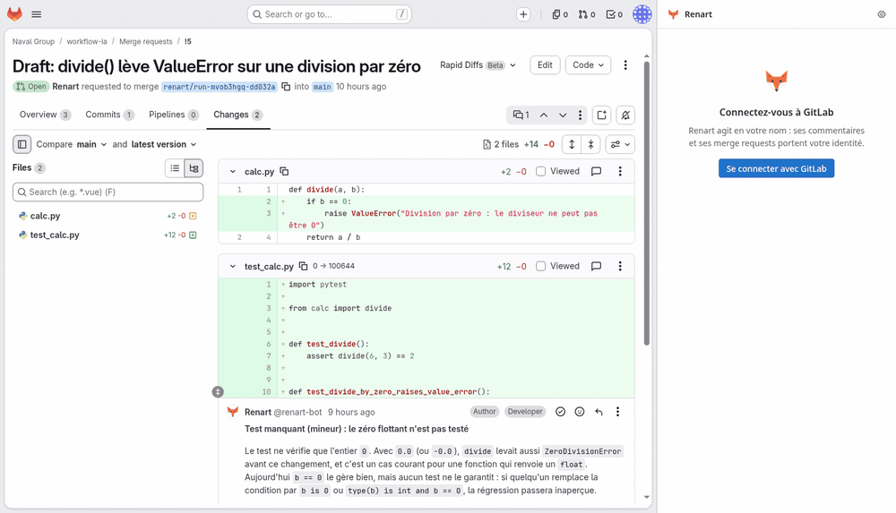

# Renart

Open source GitLab Duo-style platform: a Chrome extension launches AI workflows that run in your cluster. MIT.



## orchestrator

Node 22.18+ runs the TypeScript directly, there is no build step.

```
cd orchestrator && npm install
npm test
NODE_EXTRA_CA_CERTS=/path/to/ca.crt node --env-file=.env src/server.ts
```

`.env`: `GITLAB_URL`, `GITLAB_TOKEN` (project token on `renart/workflows`, scopes `read_api` + `read_repository`), `WORKFLOWS_PROJECT` (default `renart/workflows`), `PORT` (default 8080).

`GET /workflows?project=<group/project>&context=merge_request|issue|pipeline|project` (with `Authorization: Bearer <GitLab token>`) returns the instance workflows from `WORKFLOWS_PROJECT`, overridden by the project's `.renart/workflows/` (read with the caller's token), plus any invalid files in `errors`.

## Workflows

| Workflow | Where | What it does |
|---|---|---|
| `review-mr` | merge request | Comments on the diff lines, then one summary comment |
| `security-review` | merge request | Security-only review (injections, access control, business logic, secrets), with attack scenario and severity per finding |
| `summarize-mr` | merge request | One summary comment |
| `describe-mr` | merge request | Writes the MR description from the diff, following the project's MR template |
| `ask-mr` / `ask-project` | merge request / project | Answers the question typed in the panel from the code and the code graph, with file:line; writes nothing to GitLab |
| `tests-mr` | merge request | Missing unit tests for the changed code, in the project's framework |
| `e2e-tests` | merge request | End-to-end scenarios for the user journeys the MR changes, in the project's E2E suite (proposes one if there is none) |
| `apply-review` | merge request with unresolved threads | Applies the review comments it agrees with, replies in every thread |
| `resolve-conflicts` | merge request with conflicts | Merges the target branch and resolves the conflicts, file by file |
| `dependency-update` | Renovate/Dependabot MR or `dependencies` label | Adapts the code to the new version of a dependency |
| `fix-ci` | pipeline or job page; on a merge request or project, its failed pipelines (latest preselected) | Reads the failed jobs' logs, fixes the cause |
| `plan-issue` | issue | An implementation plan as a comment |
| `summarize-issue` | issue | Where the discussion stands: decisions, open questions, next step |
| `issue-to-mr` | issue | A branch and a draft merge request |

Workflows that change code never push to an existing branch: they open a draft MR targeting the branch they fix (the MR's source branch, or the pipeline's), and comment on the original MR with the link. Conditional actions (`when` in the workflow) only show when they apply, first in the list.

## Code graph

Workflows that list `code_graph_explore`, `code_graph_callers`, `code_graph_impact` or `code_graph_affected` get a code graph of the repository at the run's commit (the merge request head, or the default branch). A Kubernetes Job builds it with [CodeGraph](https://github.com/colbymchenry/codegraph) (tree-sitter + SQLite, 34 languages, no LLM and no API key, telemetry and self-download turned off; about a second for a small repository), with its own memory limit (measured: Flask, 18k lines, 3.6 s and a 300 MB peak; Django, 530k lines, 54 s and 2.9 GB — set `codeGraph.buildMemory` for your largest repository), and uploads the snapshot (files + index) to the orchestrator, which keeps it per project and SHA on the data volume (last 5 per project) and answers the run's queries itself: the runner never holds the graph, and a run can only query its own project and commit (per-run HMAC token, the endpoint refuses requests coming through the ingress).

## runner

One Kubernetes Job per run (`node src/main.ts`). It reads the workflow and context from env, gives Claude (Agent SDK) only the GitLab tools the workflow lists, bound to the run's project, and prints one JSON event per line.

## Deploy

Helm chart in `deploy/chart`, step by step in [docs/install.md](docs/install.md). Self-hosted models (vLLM, Ollama, agentgateway): [docs/openai-compatible.md](docs/openai-compatible.md). No Internet at all (agentgateway → vLLM): [docs/air-gap.md](docs/air-gap.md).

```
helm upgrade --install renart oci://ghcr.io/ayrayane/charts/renart --version 0.9.0 -n renart --create-namespace -f my-values.yaml --wait
```

Images: `ghcr.io/ayrayane/renart-orchestrator` and `ghcr.io/ayrayane/renart-runner`. The extension is attached to each [release](https://github.com/ayrayane/renart/releases) as a zip: unzip it and load it unpacked in Chrome (`chrome://extensions`, developer mode).

Workflows for the instance project live in `workflows/` (with their validation CI).

```
curl -X POST https://renart.<host>/runs -H "Authorization: Bearer <your GitLab token>" \
  -H 'Content-Type: application/json' -d '{"workflow":"summarize-mr","project":"group/project","mr_iid":1}'
curl -N https://renart.<host>/runs/<id>/events -H "Authorization: Bearer <your GitLab token>"
```

## extension

Plain ES modules, type-checked with `tsc` (`checkJs`), no build. Load `extension/` unpacked in Chrome/Chromium, then fill the options: GitLab URL, orchestrator URL, and the Application ID of a non-confidential GitLab OAuth application (scope `read_api`) whose redirect URI is shown on the options page.
